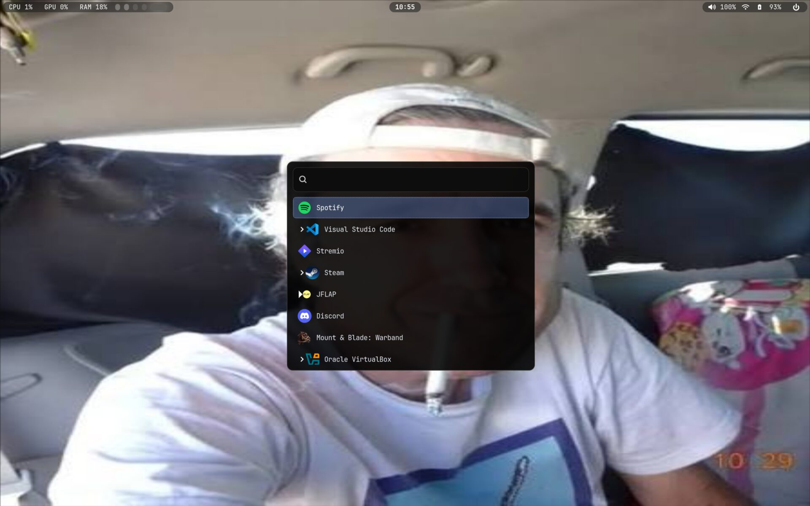
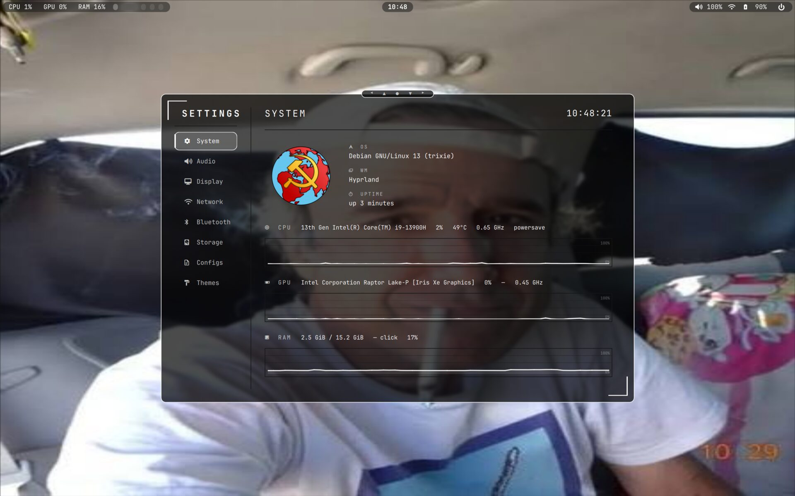
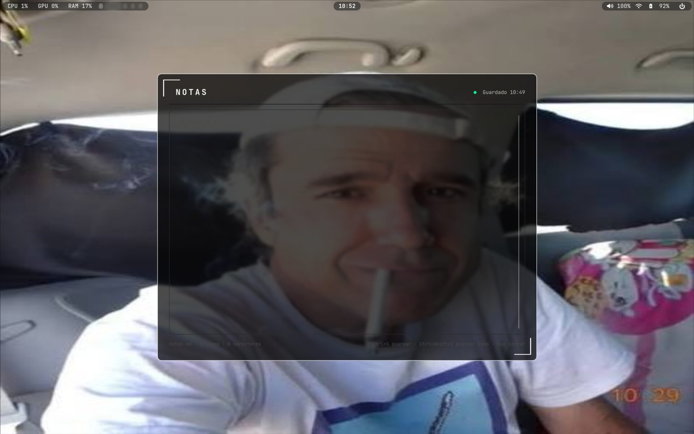
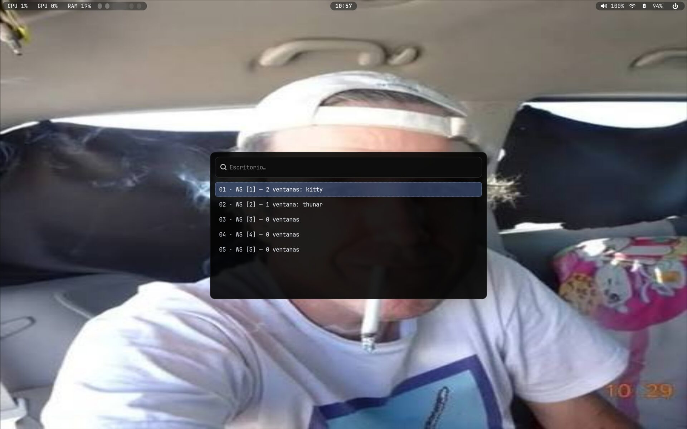
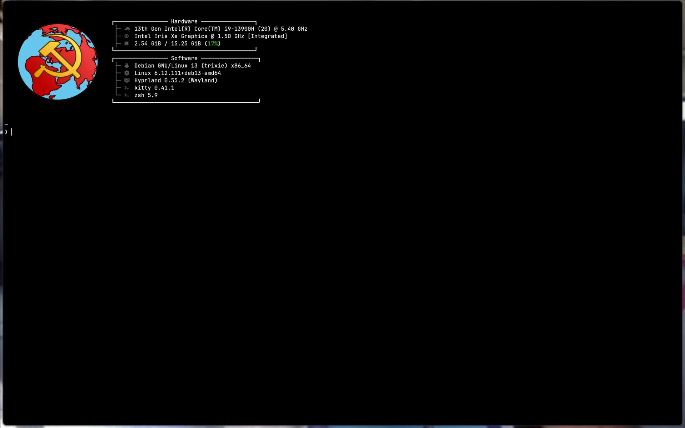

# 43PR dotfiles para Debian 13 (trixie)

[](LICENSE)
[](packages.txt)
[](#contenido)
[](https://github.com/manumuxoz/43pr-debian/releases)

Adaptación a Debian 13 del rice [43PR dotfiles](https://github.com/43PR/dotfiles)
(*"Hyprland + Quickshell setup"*), funcionando con **Hyprland 0.55 (config en
Lua)**, **Waybar 0.12** y **Quickshell 0.3**, con pantalla de login
**greetd/hyprlogin** y **desbloqueo por huella**.

> **Proyecto original:** [43PR dotfiles](https://github.com/43PR/dotfiles) —
> https://github.com/43PR/dotfiles — *"Hyprland + Quickshell setup"*, MIT, © 43PR.
> Esta es una adaptación independiente a Debian 13: todo el mérito del rice
> original (motor de temas, shell QML, diseño de keybinds) es de los autores de
> 43PR; solo el port a Debian y las adaptaciones de hardware/greeter son nuevos.

Probado en: ASUS Zenbook UX3402VA · Debian 13.7 · Hyprland 0.55.2 · Quickshell
0.3.0 · Waybar 0.12.0 · greetd 0.10.3.

> Es una configuración personal publicada como referencia para usuarios de
> Debian. No está afiliada al proyecto 43PR. Algunas partes son específicas del
> hardware y están documentadas en [`docs/hardware.md`](docs/hardware.md).
> El 43PR original apunta a distribuciones basadas en Arch; todo lo específico
> de Debian está en este repositorio.

## Capturas

Capturas del escritorio real del autor.


| Lanzador (wofi) | Ajustes de Quickshell (`SUPER+I`) |
|---|---|
|  |  |

| Selector de fondos (`SUPER+W`) | Notas (`SUPER+N`) |
|---|---|
|  |  |

| Cambiador de escritorios | fastfetch en kitty |
|---|---|
|  |  |

## Contenido

| Componente | Notas |
|---|---|
| Config de Hyprland | Archivos Lua (`hyprland.lua`, `keybinds.lua`, `look.lua`, `monitors.lua`, `rules.lua`) |
| Barra | Waybar 0.12 + `waybar-ipc-shim.py` (traduce el IPC antiguo a los dispatchers Lua de Hyprland 0.55) |
| Widgets | Quickshell: OSD de medios (volumen + media, cualquier reproductor MPRIS), panel de notificaciones, OSDs de brillo/captura/grabación, lista de tareas, menú de energía, ventana de ajustes, selector de fondos (`hyprquickpaper`) |
| Motor de temas | `~/.config/43pr/bin/theme.py` — paletas, fondos, matugen (opcional), sincronización con el login |
| Lanzadores / UI | wofi, wlogout, kitty (dunst se mantiene solo como respaldo) |
| fastfetch | Cabecera Debian ASCII animada al abrir kitty; ver [`scripts/debian-ascii/`](scripts/debian-ascii/README.md) |
| Cámara | `scripts/camera.sh` — webcam por V4L2: vista previa flotante con mpv (`SUPER+C`), foto (`s`) y grabación (`r`) desde la propia ventana |
| Pantalla de login | **hyprlogin** (greeter de greetd forkeado de hyprlock) + sincronización de tema + huella por PAM |
| Parches | fix de carrera en el desbloqueo de hyprlogin, fix de compilación de libfprint (`egismoc`) |

## Piezas específicas de Debian (por qué existe este repo)

- **Hyprland 0.55 + configuración Lua** desde trixie-backports (`start-hyprland`).
- **`graphical-session.target` nunca se activa** con `start-hyprland`: hypridle,
  hyprsunset y los portales se arrancan a mano — ver
  [`docs/debian-adaptations.md`](docs/debian-adaptations.md).
- **Waybar 0.12 vs dispatchers Lua**: el arreglo oficial aún no está en ninguna
  versión de Waybar, así que el repo incluye un shim IPC —
  [`docs/waybar-hyprland-lua-shim.md`](docs/waybar-hyprland-lua-shim.md).
- **hyprpaper 0.8.4 falla al reaplicar fondo** → el fondo lo gestiona `swaybg`
  con un shim de `awww`.
- **hyprlogin** compilado en Debian + parche de carrera —
  [`docs/hyprlogin.es.md`](docs/hyprlogin.es.md) (versión
  [en inglés](docs/hyprlogin.md)).
- **Huella** (EgisTech `1c7a:0584`) con fprintd + PAM —
  [`docs/fingerprint.md`](docs/fingerprint.md).
- **Thunar** (opcional) abre kitty en «Abrir terminal aquí» mediante
  `config/xfce4/helpers.rc`; `thunar-archive-plugin` + `ark` añaden
  «Crear archivador…», «Extraer aquí» y «Extraer en…» al menú contextual —
  ver [`docs/debian-adaptations.md`](docs/debian-adaptations.md).
- GNOME no se toca: el theming global de GTK queda desactivado a propósito.

## Instalación

```bash
# 1. Añade trixie-backports e instala los paquetes (lista completa y
#    versiones en packages.txt):
sudo apt install -t trixie-backports \
  hyprland hyprland-guiutils hypridle hyprlock hyprpaper hyprpicker \
  hyprsunset xdg-desktop-portal-hyprland quickshell
sudo apt install \
  waybar dunst wofi kitty wlogout grim slurp wl-clipboard cliphist \
  brightnessctl playerctl network-manager-gnome polkit-kde-agent-1 \
  swaybg jq imagemagick python3 greetd

# 2. Clona e instala en tu HOME (hace copia de seguridad de lo existente):
git clone https://github.com/manumuxoz/43pr-debian.git
cd 43pr-debian
./install.sh

# 3. Opcional: permite que Ajustes → Sistema → CPU MODE cambie de perfil sin
#    contraseña (instala una regla sudoers estrecha; solo una vez):
sudo bash scripts/install-cpu-profile-sudoers.sh
```

`install.sh` copia las configs a `~/.config/`, los scripts a `~/.local/bin/`,
instala Roboto Mono en `~/.local/share/fonts/43pr/` y ejecuta
`theme.py apply` para generar los archivos que no se versionan (colores, etc.).
La configuración anterior se respalda en `~/.config-backups/43pr-debian-<fecha>/`.
Con `./install.sh --dry-run` puedes previsualizar los cambios, y `./uninstall.sh`
restaura el último respaldo.

### Actualizar

Este port **copia** los archivos en tu HOME (no enlaza el repositorio con
symlinks), así que un `git pull` no cambia por sí solo la configuración viva:

```bash
git pull
./update.sh            # --dry-run para previsualizar, --diff para ver cambios
```

`update.sh` copia solo los archivos nuevos o modificados, respalda cada archivo
sobrescrito en `~/.config-backups/update-<fecha>/` (conserva los cinco últimos)
y vuelve a ejecutar `theme.py apply`. No borra archivos, no instala paquetes y
no hace `git pull`; solo informa de los paquetes que falten. Opciones útiles:
`--dry-run`, `--diff`, `--skip-theme`, `--skip-packages`, `--reload-hyprland`,
`--reload-waybar`, `--restart-shell`.

Para deshacer una instalación completa, `./uninstall.sh` restaura el respaldo
`~/.config-backups/43pr-debian-<fecha>/`. Los respaldos del updater son por
archivo y `uninstall.sh` no los usa.

### Después de instalar

1. Adapta `~/.config/hypr/monitors.lua` a tus pantallas (o usa
   `scripts/monitor-ctl.sh mode/scale/primary/reconcile`). El repo trae el
   layout original: `eDP-1 2880x1800@90 scale 1.75` + externo ASUS VW199
   (`HDMI-A-1` o `DP-3`) a `1440x900@74.98` scale 1.0. No fuerces
   `1920x1080@120`: no está en el EDID y deja el panel en negro.
2. Revisa `~/.config/quickshell/hyprquickpaper/config.json`: la carpeta de
   fondos es `$HOME/Imágenes/Wallpapers` (la crea el instalador). Ajustes →
   Temas incluye 26 presets; para que persistan al cambiar el fondo, pon
   `override = true` en el TOML del tema.
3. Cierra sesión y arranca Hyprland (`start-hyprland` desde una TTY funciona;
   greetd/hyprlogin es opcional).
4. Opcional: login con `/etc/hyprlogin` (`docs/hyprlogin.es.md`) y huella
   (`docs/fingerprint.md`).

### Atajos

Ver [`config/hypr/SHORTCUTS.md`](config/hypr/SHORTCUTS.md). Destacados:
`SUPER+W` selector de fondos, `SUPER+ALT+W` fondo aleatorio, `SUPER+I`
ajustes de Quickshell, `SUPER+N` bloc de notas, `SUPER+SHIFT+T` lista de
tareas, `SUPER+SHIFT+N` panel de notificaciones, `SUPER+SHIFT+M` panel de
medios, `SUPER+SHIFT+E` menú de energía, `SUPER+R` grabación de pantalla,
`SUPER+C` vista previa de la webcam, `SUPER+SHIFT+D` cambio de tema,
`SUPER+SHIFT+W` ocultar/mostrar Waybar.
El resto es el 43PR original (enfoque estilo vim, scratchpad, capturas en
`~/Imágenes/Capturas de pantalla`, teclas multimedia…).

## Estructura del repositorio

```
config/      archivos que van a ~/.config/ (hypr, waybar, quickshell, 43pr, …)
local/bin/   helpers que van a ~/.local/bin/ (shim de awww, screen-record.sh)
assets/      fuentes (Roboto Mono)
etc/         archivos de sistema para el greeter (greetd, hyprlogin, PAM)
patches/     fix de hyprlogin, fix de compilación de libfprint (egismoc)
scripts/     utilidades del greeter (sincronización, rescate, instalación)
docs/        notas de Debian, shim, greeter, huella y hardware
tools/       upstream-diff.sh, doctor.sh (diagnóstico) y check-links.py (CI)
.github/     workflow de CI + plantilla de issue de hardware
packages.txt referencia de paquetes apt
install.sh   instalador a nivel de usuario (admite --dry-run)
update.sh    copia archivos nuevos/modificados sobre una instalación existente
uninstall.sh restaura la configuración previa
CHANGELOG.md notas de versión
```

Los archivos generados al instalar (`hypr/colors.lua`, `hyprlock-colors.conf`,
`waybar/colors.css`, `wlogout/colors.css`, `wofi/style.css`,
`kitty/matugen.conf`, `btop/themes/43pr.theme`) **no** se versionan;
`theme.py apply` los recrea. El target de cava queda desactivado hasta que
Debian incluya cava >= 0.10.5.

## Créditos y licencia

Este repositorio es una **adaptación a Debian 13 de los [43PR dotfiles](https://github.com/43PR/dotfiles)**
(https://github.com/43PR/dotfiles), MIT © 43PR — la mayoría de archivos bajo
`config/` provienen del proyecto original y conservan su licencia MIT. Consulta
[`NOTICE.md`](NOTICE.md) para la atribución completa y [`LICENSES/`](LICENSES/)
para los textos de licencia.

La adaptación se publica bajo licencia MIT (ver [`LICENSE`](LICENSE)). hyprlogin
es BSD-3-Clause (© 2024 Hypr Development); el shim IPC de Waybar da soporte a
dos PRs todavía sin fusionar en upstream; el parche de libfprint hace referencia
a un proyecto LGPL-2.1 (solo el parche — no se redistribuye código original). No
se incluye ningún fondo ni imagen personal del setup original; las capturas de
este README muestran el escritorio real del autor.
